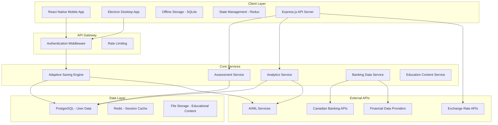
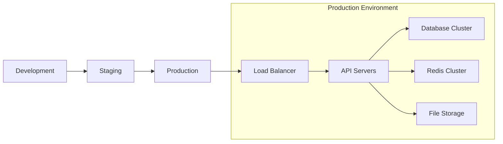

# Design Document

## Overview

SaveBetter is a cross-platform financial planning application that revolutionizes personal finance management through three core innovations: an Adaptive Saving Engine that adjusts to real spending patterns, a Dual Assessment System combining technical knowledge and behavioral analysis, and comprehensive Personal Saving Analytics. The application targets the Canadian market with localized banking integration, tax optimization guidance, and regulatory compliance, providing seamless experiences across mobile and desktop platforms.

### Key Design Principles

- **Adaptive Intelligence**: Move beyond rigid budgeting rules to personalized, achievable financial goals
- **Educational First**: Provide comprehensive financial literacy with Canadian-specific guidance
- **Cross-Platform**: Seamless experience across mobile and desktop devices with offline capabilities
- **Privacy-Focused**: Secure handling of sensitive financial data with Canadian compliance
- **Gamified Engagement**: Motivational features that build sustainable financial habits

## Architecture

### High-Level Architecture



### Cross-Platform Strategy

**Implementation Approach:**
- **Shared Core**: Business logic, API services, and data models shared between platforms
- **Platform-Specific UI**: Native-feeling interfaces optimized for each platform
- **Unified Backend**: Single API serving both mobile and desktop clients
- **Consistent Experience**: Same features and data across all platforms with platform-appropriate UX

**Code Sharing Structure:**
```
src/
├── shared/           # 80% shared code
│   ├── services/     # API calls, business logic
│   ├── store/        # Redux store and reducers
│   ├── utils/        # Helper functions
│   └── types/        # TypeScript interfaces
├── mobile/           # React Native specific
│   ├── components/   # Mobile UI components
│   ├── screens/      # Mobile screen layouts
│   └── navigation/   # React Navigation setup
└── desktop/          # Electron specific
    ├── components/   # Desktop UI components
    ├── pages/        # Desktop page layouts
    └── routing/      # React Router setup
```

**Platform-Specific Adaptations:**
- **Mobile**: Touch gestures, swipe navigation, mobile-optimized charts
- **Desktop**: Keyboard shortcuts, hover states, resizable windows, menu bars
- **Responsive Design**: Adaptive layouts that work on tablets and various screen sizes

### Technology Stack

**Frontend:**
- React Native for mobile development (iOS/Android)
- Electron for desktop development (Windows/macOS/Linux)
- Shared React components and business logic
- Redux for state management across platforms
- React Navigation (mobile) / React Router (desktop) for routing
- Chart.js for data visualization (works on both platforms)
- SQLite for offline data persistence (both platforms)
- Platform-specific UI adaptations

**Backend:**
- Node.js with Express.js framework
- PostgreSQL for relational data storage
- Redis for caching and session management
- JWT for authentication
- Helmet.js for security headers

**External Integrations:**
- Canadian banking institution APIs (where available)
- Financial data providers (Alpha Vantage, Yahoo Finance)
- Exchange rate APIs for crypto calculations
- AI/ML Services (OpenAI GPT-4, Google Cloud AI, Azure Cognitive Services)
- Natural Language Processing for expense categorization
- Machine Learning models for spending pattern prediction

## Components and Interfaces

### Core Components

#### 1. Adaptive Saving Engine

**Purpose**: Analyzes spending patterns and dynamically adjusts saving percentages

**Key Methods:**
```typescript
interface AdaptiveSavingEngine {
  analyzeSpendingPatterns(expenses: Expense[], timeframe: number): SpendingAnalysis;
  calculateRealisticSavings(income: number, expenses: Expense[]): SavingsRecommendation;
  adjustSavingsGoal(currentGoal: number, performance: SavingsPerformance): number;
  generatePersonalizedTips(analysis: SpendingAnalysis): string[];
}

interface SavingsRecommendation {
  recommendedPercentage: number;
  confidenceLevel: number;
  reasoning: string;
  adjustmentHistory: PercentageAdjustment[];
}
```

**Algorithm Logic:**
1. Calculate disposable income after fixed expenses
2. Apply 20% buffer for unexpected costs
3. Determine maximum sustainable savings rate
4. Start with achievable percentage (may be lower than 20%)
5. Gradually increase as user builds consistency

#### 2. Dual Assessment System

**Purpose**: Combines technical knowledge and behavioral assessment for personalized recommendations

**Components:**
```typescript
interface AssessmentSystem {
  conductSkillAssessment(): SkillLevel;
  conductPersonalityQuiz(): InvestmentPersonality;
  generateCombinedProfile(skill: SkillLevel, personality: InvestmentPersonality): UserProfile;
  getRecommendations(profile: UserProfile): InvestmentRecommendation[];
}

interface UserProfile {
  skillLevel: 'beginner' | 'intermediate' | 'advanced';
  personality: 'steady_builder' | 'balanced_explorer' | 'growth_seeker';
  riskTolerance: number;
  educationPath: string;
  recommendedStrategies: string[];
}
```

**Recommendation Matrix:**
- Beginner + Steady Builder → Ultra-conservative education focus
- Intermediate + Balanced Explorer → Moderate growth strategies
- Advanced + Growth Seeker → Full strategy access with risk management

#### 3. Personal Analytics Dashboard

**Purpose**: Provides comprehensive insights into saving patterns and financial behavior

**Features:**
```typescript
interface AnalyticsDashboard {
  generateSavingsTrends(timeframe: TimeRange): TrendData;
  calculatePerformanceMetrics(goals: Goal[], actual: Transaction[]): PerformanceMetrics;
  identifySpendingPatterns(transactions: Transaction[]): SpendingInsights;
  generatePersonalizedInsights(userData: UserData): Insight[];
}

interface PerformanceMetrics {
  savingsRate: number;
  goalAchievementRate: number;
  consistencyScore: number;
  improvementTrend: number;
  categoryBreakdown: CategorySpending[];
}
```

#### 4. AI-Powered Analysis Engine

**Purpose**: Leverages artificial intelligence to provide intelligent financial insights, predictions, and personalized recommendations

**AI Features:**
```typescript
interface AIAnalysisEngine {
  analyzeSpendingPatterns(transactions: Transaction[]): Promise<SpendingInsights>;
  predictFutureExpenses(historicalData: FinancialData): Promise<ExpensePrediction>;
  generatePersonalizedAdvice(userProfile: UserProfile, context: FinancialContext): Promise<AIAdvice>;
  categorizeTransactions(descriptions: string[]): Promise<CategoryPrediction[]>;
  detectAnomalousSpending(transactions: Transaction[]): Promise<AnomalyAlert[]>;
  optimizeSavingsStrategy(goals: Goal[], constraints: Constraint[]): Promise<OptimizationSuggestion>;
}

interface AIAdvice {
  insights: string[];
  recommendations: Recommendation[];
  confidenceScore: number;
  reasoning: string;
  actionItems: ActionItem[];
}
```

**AI Use Cases:**

1. **Smart Expense Categorization**
   - Automatically categorize transactions using NLP
   - Learn from user corrections to improve accuracy
   - Handle complex transaction descriptions

2. **Predictive Analytics**
   - Forecast future expenses based on patterns
   - Predict income fluctuations for gig workers
   - Anticipate seasonal spending changes

3. **Personalized Financial Coaching**
   - Generate contextual financial advice
   - Explain complex financial concepts in simple terms
   - Provide motivational messages based on progress

4. **Anomaly Detection**
   - Identify unusual spending patterns
   - Alert users to potential fraud or overspending
   - Suggest budget adjustments for irregular expenses

5. **Goal Optimization**
   - Recommend optimal savings allocation across multiple goals
   - Suggest timeline adjustments based on realistic projections
   - Identify opportunities to accelerate goal achievement

**AI Service Integration:**
```typescript
// OpenAI Integration for Financial Coaching
class FinancialCoachAI {
  async generateAdvice(userContext: UserContext): Promise<CoachingAdvice> {
    const prompt = this.buildContextualPrompt(userContext);
    const response = await openai.chat.completions.create({
      model: "gpt-4",
      messages: [
        { role: "system", content: "You are a Canadian financial advisor..." },
        { role: "user", content: prompt }
      ],
      temperature: 0.7,
      max_tokens: 500
    });
    return this.parseAdviceResponse(response);
  }
}

// Google Cloud AI for Transaction Categorization
class TransactionCategorizerAI {
  async categorizeTransaction(description: string): Promise<Category> {
    const request = {
      document: { content: description, type: 'PLAIN_TEXT' },
      features: { classifyText: {} }
    };
    const response = await this.languageClient.classifyText(request);
    return this.mapToFinancialCategory(response);
  }
}
```

#### 5. Canadian Banking Integration

**Purpose**: Provides real-time rates and information from major Canadian financial institutions

**Data Sources:**
- Major Banks: RBC, TD, BMO, Scotiabank, CIBC
- Online Banks: Tangerine, EQ Bank, Simplii Financial
- Credit Unions: Regional options by province

**Implementation:**
```typescript
interface BankingService {
  fetchCurrentRates(): Promise<BankRate[]>;
  compareProducts(criteria: ProductCriteria): ProductComparison[];
  getAccountFeatures(bankId: string, productId: string): AccountFeatures;
  updateRatesCache(): Promise<void>;
}

interface BankRate {
  institution: string;
  productType: 'savings' | 'gic' | 'tfsa';
  interestRate: number;
  minimumDeposit: number;
  features: string[];
  lastUpdated: Date;
}
```

### User Interface Components

#### 1. Onboarding Flow
- Welcome screen with value proposition
- Salary input with real-time calculation
- Spending history input (optional)
- Goal setting interface
- Assessment completion

#### 2. Main Dashboard
- Adaptive savings recommendation
- Progress visualization
- Quick actions (add expense, update goal)
- Educational content suggestions
- Achievement notifications

#### 3. Assessment Interface
- Skill level questions with clear explanations
- Personality quiz with engaging visuals
- Combined results presentation
- Recommendation display

#### 4. Analytics Dashboard
- Interactive charts and graphs
- Performance metrics
- Trend analysis
- Personalized insights
- Goal tracking

## Data Models

### Core Data Entities

```typescript
// User Profile
interface User {
  id: string;
  email: string;
  profile: {
    age: number;
    income: number;
    province: string;
    skillLevel: SkillLevel;
    personality: InvestmentPersonality;
    riskTolerance: number;
  };
  preferences: {
    theme: 'light' | 'dark';
    notifications: boolean;
    currency: 'CAD';
  };
  createdAt: Date;
  lastActive: Date;
}

// Financial Goals
interface Goal {
  id: string;
  userId: string;
  type: 'emergency' | 'retirement' | 'house' | 'vacation' | 'custom';
  targetAmount: number;
  currentAmount: number;
  targetDate: Date;
  priority: number;
  adaptivePercentage: number;
  isActive: boolean;
}

// Transactions and Expenses
interface Transaction {
  id: string;
  userId: string;
  amount: number;
  category: ExpenseCategory;
  type: 'income' | 'expense' | 'savings';
  date: Date;
  description: string;
  isRecurring: boolean;
}

// Assessment Results
interface AssessmentResult {
  id: string;
  userId: string;
  skillScore: number;
  skillLevel: SkillLevel;
  personalityAnswers: number[];
  personalityType: InvestmentPersonality;
  completedAt: Date;
  recommendations: string[];
}

// Banking Data
interface BankProduct {
  id: string;
  institution: string;
  productName: string;
  type: 'savings' | 'gic' | 'tfsa' | 'rrsp';
  interestRate: number;
  minimumDeposit: number;
  features: ProductFeature[];
  eligibility: EligibilityCriteria;
  lastUpdated: Date;
}

// AI Analysis Data
interface AIInsight {
  id: string;
  userId: string;
  type: 'spending_pattern' | 'prediction' | 'recommendation' | 'anomaly';
  content: string;
  confidenceScore: number;
  dataPoints: any[];
  generatedAt: Date;
  userFeedback?: 'helpful' | 'not_helpful';
  actionTaken?: boolean;
}

interface SpendingPrediction {
  id: string;
  userId: string;
  category: string;
  predictedAmount: number;
  timeframe: 'week' | 'month' | 'quarter';
  confidence: number;
  factors: PredictionFactor[];
  createdAt: Date;
}

interface AICoachingSession {
  id: string;
  userId: string;
  query: string;
  response: string;
  context: FinancialContext;
  satisfaction?: number;
  followUpNeeded: boolean;
  createdAt: Date;
}
```

### Database Schema Design

**Users Table:**
- Primary user information and preferences
- Encrypted sensitive data
- Audit trail for security

**Goals Table:**
- Financial objectives with adaptive percentages
- Progress tracking
- Priority management

**Transactions Table:**
- Financial activity logging
- Category classification
- Recurring transaction patterns

**Assessments Table:**
- Assessment results and history
- Recommendation tracking
- Profile evolution

**Bank_Products Table:**
- Current financial product information
- Rate history for trend analysis
- Feature comparison data

## Error Handling

### Error Categories

1. **User Input Errors**
   - Invalid salary amounts
   - Incomplete assessment responses
   - Invalid goal parameters

2. **External API Errors**
   - Banking API failures
   - Rate data unavailability
   - Network connectivity issues

3. **System Errors**
   - Database connection failures
   - Authentication issues
   - Cache invalidation problems

### Error Handling Strategy

```typescript
interface ErrorHandler {
  handleUserInputError(error: ValidationError): UserFriendlyMessage;
  handleAPIError(error: APIError): FallbackStrategy;
  handleSystemError(error: SystemError): RecoveryAction;
  logError(error: Error, context: ErrorContext): void;
}

// Graceful Degradation
const fallbackStrategies = {
  bankingAPI: 'Use cached rates with timestamp',
  exchangeRates: 'Use last known rates',
  analytics: 'Show basic calculations',
  recommendations: 'Use default conservative approach'
};
```

### User Experience During Errors

- Clear, non-technical error messages
- Suggested actions for resolution
- Graceful fallbacks to cached data
- Offline mode for core calculations
- Retry mechanisms with exponential backoff

## Testing Strategy

### Testing Pyramid

#### 1. Unit Tests (70%)
- Adaptive Saving Engine calculations
- Assessment scoring algorithms
- Data validation functions
- Utility functions

#### 2. Integration Tests (20%)
- API endpoint testing
- Database operations
- External service integrations
- Authentication flows

#### 3. End-to-End Tests (10%)
- Complete user journeys
- Cross-platform compatibility
- Performance under load
- Security penetration testing

### Test Implementation

```typescript
// Example Unit Test
describe('AdaptiveSavingEngine', () => {
  test('calculates realistic savings for high earner', () => {
    const engine = new AdaptiveSavingEngine();
    const result = engine.calculateRealisticSavings(100000, mockExpenses);
    expect(result.recommendedPercentage).toBeGreaterThanOrEqual(0.15);
    expect(result.confidenceLevel).toBeGreaterThan(0.8);
  });

  test('adjusts down for tight budget', () => {
    const engine = new AdaptiveSavingEngine();
    const result = engine.calculateRealisticSavings(40000, highExpenses);
    expect(result.recommendedPercentage).toBeLessThan(0.10);
    expect(result.reasoning).toContain('tight budget');
  });
});
```

### Performance Testing

- Load testing for concurrent users
- Database query optimization
- Mobile app performance profiling
- Memory usage monitoring
- Battery consumption analysis

### Security Testing

- Authentication bypass attempts
- Data encryption validation
- API security scanning
- Privacy compliance verification
- Penetration testing for financial data

## Security and Privacy

### Data Protection

1. **Encryption**
   - AES-256 for data at rest
   - TLS 1.3 for data in transit
   - End-to-end encryption for sensitive operations

2. **Authentication**
   - JWT tokens with short expiration
   - Biometric authentication support
   - Multi-factor authentication option

3. **Privacy Compliance**
   - PIPEDA compliance for Canadian users
   - Minimal data collection principle
   - User consent management
   - Right to data deletion

4. **AI Data Privacy**
   - Data anonymization before AI processing
   - No personal identifiers sent to AI services
   - Local processing where possible
   - AI model output filtering for sensitive information
   - User consent for AI-powered features
   - Transparent AI decision-making explanations

### Security Architecture

```typescript
interface SecurityService {
  encryptSensitiveData(data: any): EncryptedData;
  validateUserPermissions(userId: string, resource: string): boolean;
  auditUserAction(action: UserAction): void;
  detectAnomalousActivity(userId: string): SecurityAlert[];
}

// Data Classification
const dataClassification = {
  public: ['educational_content', 'bank_rates'],
  internal: ['user_preferences', 'assessment_results'],
  confidential: ['financial_data', 'personal_info'],
  restricted: ['authentication_tokens', 'encryption_keys']
};
```

## Performance Considerations

### Cross-Platform Optimization

1. **Shared Code Architecture**
   - 80% shared business logic between platforms
   - Platform-specific UI components
   - Unified API layer and state management

2. **Mobile Optimization**
   - App size optimization with code splitting
   - Battery-efficient background processing
   - Touch-optimized interface design

3. **Desktop Optimization**
   - Keyboard shortcuts and accessibility
   - Multi-window support for advanced users
   - Larger screen real estate utilization
   - Native OS integration (notifications, file system)

4. **Network Optimization**
   - Request batching
   - Compression for API responses
   - Offline-first architecture for both platforms

### Scalability Design

1. **Database Optimization**
   - Proper indexing strategy
   - Query optimization
   - Connection pooling

2. **Caching Strategy**
   - Redis for session data
   - Application-level caching
   - CDN for static content

3. **API Design**
   - RESTful endpoints
   - Pagination for large datasets
   - Rate limiting protection

## Deployment and DevOps

### Deployment Architecture



### CI/CD Pipeline

1. **Continuous Integration**
   - Automated testing on commit
   - Code quality checks
   - Security scanning
   - Performance benchmarks

2. **Continuous Deployment**
   - Staging environment validation
   - Blue-green deployment
   - Automated rollback capability
   - Health monitoring

### Monitoring and Observability

1. **Application Monitoring**
   - Error tracking and alerting
   - Performance metrics
   - User behavior analytics
   - Business metrics dashboard

2. **Infrastructure Monitoring**
   - Server health monitoring
   - Database performance
   - API response times
   - Security event logging

## Additional Value-Adding Features

### 1. Receipt Scanning and Expense Tracking
**Purpose**: Simplify expense tracking through automation

**Features:**
- **OCR Receipt Scanning**: Automatically extract amount, merchant, and category
- **Smart Categorization**: AI-powered expense categorization
- **Subscription Detection**: Identify and track recurring subscriptions
- **Expense Splitting**: Split bills with friends/family and track who owes what
- **Tax Deduction Tracking**: Identify potential tax-deductible expenses

**Technical Implementation:**
```typescript
interface ReceiptScannerService {
  scanReceipt(imageData: ImageData): Promise<ReceiptData>;
  categorizeExpense(merchantName: string, amount: number): Promise<Category>;
  detectSubscriptions(transactions: Transaction[]): Promise<Subscription[]>;
  identifyTaxDeductions(transactions: Transaction[]): Promise<TaxDeduction[]>;
}

interface ReceiptData {
  merchant: string;
  amount: number;
  date: Date;
  items: LineItem[];
  suggestedCategory: Category;
  confidence: number;
}
```

### 2. Canadian Tax Optimization Engine
**Purpose**: Maximize tax efficiency for Canadian users

**Features:**
- **RRSP vs TFSA Optimizer**: Recommend optimal contribution strategy
- **Tax Bracket Analysis**: Show impact of income changes on tax liability
- **Deduction Maximizer**: Identify missed tax deductions
- **Provincial Tax Differences**: Compare tax implications across provinces
- **Tax Refund Planner**: Suggest optimal use of tax refunds

**Technical Implementation:**
```typescript
interface TaxOptimizationEngine {
  optimizeContributions(income: number, province: string): ContributionStrategy;
  analyzeTaxBrackets(currentIncome: number, projectedIncome: number): TaxAnalysis;
  findDeductions(transactions: Transaction[], userProfile: UserProfile): Deduction[];
  compareProvinces(income: number): ProvincialComparison[];
  planRefundUsage(refundAmount: number, goals: Goal[]): RefundStrategy;
}

interface ContributionStrategy {
  rrspRecommendation: number;
  tfsaRecommendation: number;
  reasoning: string;
  taxSavings: number;
  optimalTiming: string;
}
```

### 3. Financial Health Score
**Purpose**: Gamify financial wellness with comprehensive scoring

**Features:**
- **Multi-Factor Scoring**: Savings rate, debt ratio, emergency fund, diversification
- **Improvement Recommendations**: Specific actions to improve score
- **Peer Comparison**: Anonymous comparison with similar demographics
- **Progress Tracking**: Historical score trends and milestones
- **Achievement Badges**: Unlock badges for financial milestones

**Technical Implementation:**
```typescript
interface FinancialHealthEngine {
  calculateHealthScore(financialData: FinancialData): HealthScore;
  generateImprovementPlan(currentScore: HealthScore): ImprovementPlan;
  compareToPeers(userProfile: UserProfile, score: HealthScore): PeerComparison;
  trackProgress(userId: string): ProgressHistory;
  checkAchievements(userId: string, newScore: HealthScore): Achievement[];
}

interface HealthScore {
  overall: number; // 0-1000
  components: {
    savingsRate: number;
    debtRatio: number;
    emergencyFund: number;
    diversification: number;
    budgetAdherence: number;
  };
  grade: 'A' | 'B' | 'C' | 'D' | 'F';
  improvements: string[];
}
```

### 4. Investment Portfolio Tracker
**Purpose**: Comprehensive investment monitoring and optimization

**Features:**
- **Portfolio Performance**: Track investments across multiple accounts
- **Asset Allocation Analysis**: Ensure proper diversification
- **Rebalancing Alerts**: Notify when portfolio drifts from target allocation
- **Dividend Tracking**: Monitor dividend income and reinvestment
- **Tax-Loss Harvesting**: Identify opportunities to minimize taxes

**Technical Implementation:**
```typescript
interface PortfolioTracker {
  syncPortfolios(accounts: InvestmentAccount[]): Promise<Portfolio[]>;
  analyzeAllocation(portfolio: Portfolio): AllocationAnalysis;
  checkRebalancing(portfolio: Portfolio, targetAllocation: Allocation): RebalanceRecommendation;
  trackDividends(holdings: Holding[]): DividendSummary;
  identifyTaxLossOpportunities(holdings: Holding[]): TaxLossOpportunity[];
}

interface Portfolio {
  accounts: InvestmentAccount[];
  totalValue: number;
  allocation: AssetAllocation;
  performance: PerformanceMetrics;
  dividendYield: number;
  unrealizedGains: number;
}
```

### 5. Financial Planning Scenarios
**Purpose**: Help users plan for major life events

**Features:**
- **Life Event Planning**: Marriage, children, career change, retirement
- **What-If Analysis**: Impact of salary changes, major purchases, etc.
- **Emergency Planning**: Calculate emergency fund needs based on lifestyle
- **Retirement Projections**: Canadian pension integration (CPP, OAS, employer plans)
- **Education Savings**: RESP planning and contribution optimization

**Technical Implementation:**
```typescript
interface ScenarioPlanner {
  planLifeEvent(event: LifeEvent, userProfile: UserProfile): EventPlan;
  runWhatIfAnalysis(scenario: Scenario, currentFinances: FinancialData): ImpactAnalysis;
  calculateEmergencyFund(expenses: MonthlyExpenses, riskProfile: RiskProfile): EmergencyFundPlan;
  projectRetirement(income: number, savings: number, age: number): RetirementProjection;
  optimizeRESP(childAge: number, educationGoals: EducationGoals): RESPStrategy;
}

interface EventPlan {
  event: LifeEvent;
  estimatedCost: number;
  savingsRequired: number;
  timeframe: number;
  milestones: Milestone[];
  adjustments: BudgetAdjustment[];
}
```

### 6. Smart Notifications and Proactive Management
**Purpose**: Proactive financial management assistance

**Features:**
- **Bill Due Reminders**: Never miss a payment with smart scheduling
- **Budget Overspend Alerts**: Real-time notifications when approaching limits
- **Goal Milestone Celebrations**: Celebrate progress achievements
- **Market Opportunity Alerts**: Notify about favorable rates or investment opportunities
- **Unusual Spending Alerts**: Flag potentially fraudulent transactions

**Technical Implementation:**
```typescript
interface NotificationEngine {
  schedulePaymentReminders(bills: Bill[]): void;
  monitorBudgetLimits(userId: string, spending: Transaction[]): void;
  celebrateMilestones(userId: string, goals: Goal[]): void;
  alertMarketOpportunities(userProfile: UserProfile, marketData: MarketData): void;
  detectAnomalousSpending(userId: string, transactions: Transaction[]): void;
}
```

### 7. Integration Ecosystem
**Purpose**: Connect with users' existing financial tools

**Features:**
- **Bank Account Linking**: Secure connection to Canadian banks (Open Banking)
- **Credit Score Monitoring**: Integration with Canadian credit bureaus
- **Investment Account Sync**: Connect with brokerages and robo-advisors
- **Accounting Software**: Export data to TurboTax, other tax software
- **Calendar Integration**: Sync financial deadlines and goals

**Technical Implementation:**
```typescript
interface IntegrationService {
  connectBankAccount(bankCredentials: BankCredentials): Promise<BankConnection>;
  syncCreditScore(userId: string): Promise<CreditScore>;
  linkInvestmentAccount(brokerageInfo: BrokerageInfo): Promise<InvestmentConnection>;
  exportTaxData(userId: string, taxYear: number): Promise<TaxExport>;
  syncCalendar(userId: string, calendarService: CalendarService): Promise<void>;
}
```

### 8. Advanced Analytics and Insights
**Purpose**: Provide institutional-level financial analysis to individuals

**Features:**
- **Cash Flow Forecasting**: Predict future cash positions
- **Spending Pattern Analysis**: Identify seasonal trends and anomalies
- **Investment Performance Attribution**: Understand what drives returns
- **Risk Assessment**: Comprehensive financial risk analysis
- **Optimization Recommendations**: AI-powered suggestions for improvement

**Technical Implementation:**
```typescript
interface AdvancedAnalytics {
  forecastCashFlow(historicalData: FinancialData, timeframe: number): CashFlowForecast;
  analyzeSpendingPatterns(transactions: Transaction[]): SpendingAnalysis;
  attributePerformance(portfolio: Portfolio, benchmark: Benchmark): PerformanceAttribution;
  assessRisk(financialProfile: FinancialProfile): RiskAssessment;
  generateOptimizations(userData: UserData): OptimizationRecommendation[];
}
```

## AI Integration Considerations

### Cost Management
- **API Usage Optimization**: Batch AI requests and cache results to minimize costs
- **Tiered AI Features**: Basic AI features free, advanced AI coaching in premium tier
- **Local Processing**: Use on-device ML models for simple categorization tasks
- **Smart Caching**: Cache AI insights and predictions to reduce redundant API calls

### AI Ethics and Transparency
- **Explainable AI**: Provide clear explanations for AI recommendations
- **Bias Prevention**: Regular auditing of AI outputs for fairness across demographics
- **User Control**: Allow users to opt-out of AI features or provide feedback
- **Human Oversight**: Financial advisors review AI recommendations for accuracy

### Performance Optimization
- **Async Processing**: AI analysis runs in background without blocking UI
- **Progressive Enhancement**: App works fully without AI, enhanced with AI features
- **Fallback Mechanisms**: Traditional algorithms when AI services are unavailable
- **Response Time Limits**: Timeout AI requests to maintain app responsiveness

This design provides a comprehensive foundation for building SaveBetter as a scalable, secure, and AI-enhanced financial planning application tailored specifically for the Canadian market.